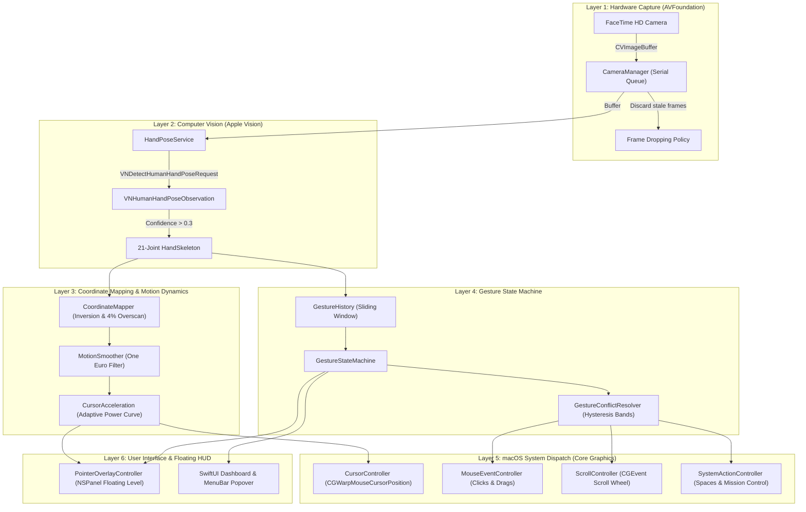

# Swipy — System Architecture & Design Specification

This document provides a comprehensive technical overview of **Swipy**, detailing the 6-layer pipeline that transforms continuous camera frames into native macOS cursor and gesture interactions.

---

## 1. High-Level Architecture

---

## 2. Pipeline Layers

### Layer 1: Hardware Capture (AVFoundation)
- **Files**: `CameraManager.swift`, `CameraFrameProvider.swift`, `CameraPermissionManager.swift`
- **Camera Selection**: Enumerates video devices preferring the built-in FaceTime HD front-facing camera.
- **Frame Rate & Resolution**: Configured to capture at 720p/1080p at 30 frames per second.
- **Backpressure & Frame Dropping**: AVFoundation captures frames onto a dedicated serial dispatch queue (`com.swipy.camera.capture`). If Vision inference falls behind, newly arrived frames are immediately discarded to guarantee zero cursor latency accumulation.

### Layer 2: Computer Vision (Apple Vision)
- **Files**: `HandPoseService.swift`, `HandLandmark.swift`, `HandPoseResult.swift`
- **Model**: Uses Apple's native `VNDetectHumanHandPoseRequest` (`maximumHandCount = 1` for primary tracking, up to 2 for multi-hand gestures).
- **Landmark Extraction**: Extracts all 21 keypoints across 5 finger chains (wrist, thumb, index, middle, ring, little).
- **Confidence Gating**: Points below minimum confidence ($0.30$) are rejected to prevent spurious tracking jumps.
- **Normalized Geometry**: Coordinates are normalized to $[0.0, 1.0]$ in camera space and converted to Cartesian metrics.

### Layer 3: Coordinate Mapping & Motion Dynamics
- **Files**: `CoordinateMapper.swift`, `MotionSmoother.swift`, `CursorAcceleration.swift`
- **Origin Inversion**: Camera frames present a bottom-left origin ($y=0$ at bottom); macOS screens use top-left origin ($y=0$ at top). `CoordinateMapper` mirrors the $X$-axis (natural selfie-mode) and inverts $Y$.
- **Overscan Margin**: Implements an overscan buffer ($4\%$) so users can reach display corners, the menu bar, and the Dock without unnatural hand contortion.
- **One Euro Filter**:
  $$\hat{X}_k = \alpha X_k + (1 - \alpha) \hat{X}_{k-1}$$
  Dynamically adapts cutoff frequency between $f_{c,\min} = 1.0\text{ Hz}$ (stillness damping) and $f_{c,\max} = 15.0\text{ Hz}$ (fast movements), eliminating trembling while preserving responsiveness.
- **Adaptive Acceleration**:
  $$v_{\text{out}} = v_{\text{in}} \cdot (1 + \alpha \cdot |v_{\text{in}}|^\gamma)$$
  Applies non-linear power curve acceleration: micro-adjustments receive precision damping, while quick hand flicks propel the cursor across widescreen displays.

### Layer 4: Gesture Recognition & State Machine
- **Files**: `GestureStateMachine.swift`, `GestureConflictResolver.swift`, `GestureDefinitions.swift`
- **Temporal Window**: Maintains a sliding buffer of hand skeletons over the past $500\text{ ms}$.
- **Hysteresis Bands**:
  - Pinch activation: $\|P_{\text{thumb}} - P_{\text{index}}\| < 0.045$
  - Pinch release: $\|P_{\text{thumb}} - P_{\text{index}}\| > 0.060$
  This deadband band prevents state flickering during boundary transitions.
- **Gesture Classification**:
  - **Left Click**: Quick pinch-and-release ($< 250\text{ ms}$).
  - **Double Click**: Two consecutive pinches within $380\text{ ms}$.
  - **Right Click**: Thumb + middle finger pinch.
  - **Drag and Drop**: Sustained pinch ($> 250\text{ ms}$) with position displacement.
  - **Two-Finger Scroll**: Index and middle fingers extended parallel, moving in sync.
  - **Spaces & Mission Control**: Three-finger directional sweeps with cooldown interlocks.

### Layer 5: macOS System Dispatch (Core Graphics)
- **Files**: `CursorController.swift`, `MouseEventController.swift`, `ScrollController.swift`, `SystemActionController.swift`
- **Cursor Positioning**: Dispatched via `CGWarpMouseCursorPosition` combined with synthetic `kCGEventMouseMoved`.
- **Mouse Clicks**: Synthesizes `kCGEventLeftMouseDown` / `kCGEventLeftMouseUp` and `kCGEventRightMouseDown`.
- **Fail-Safe Safety Release**: If camera tracking is interrupted or hand presence drops during a drag, `safetyReleaseHeldButtons()` automatically releases all depressed mouse buttons to prevent accidental system locking.
- **Scroll Wheels**: Emits smooth `CGEventCreateScrollWheelEvent2` with `kCGScrollEventUnitPixel`.

### Layer 6: Visual Pointer HUD & Interface
- **Files**: `PointerOverlayController.swift`, `PointerOverlayView.swift`, `DashboardView.swift`
- **Click-Through NSPanel**: Rendered on a borderless, non-activating `NSPanel` at `NSWindow.Level.floating`, configured with `.canJoinAllSpaces` and `.fullScreenAuxiliary`. Ignores mouse events (`ignoresMouseEvents = true`) so clicks pass seamlessly to target applications.
- **Visual Styles**: Vision Pro Ring, Glow Halo, Laser Dot, and Precision Crosshair, with spring-animated pinch contractions and expanding ripple pulses.

---

## 3. Concurrency & Thread-Safety Model

- **Background Inference**: Camera streaming and Vision requests run on private serial queues.
- **State Coordination**: `AppLifecycleManager` is decorated with `@MainActor` to ensure UI state bindings update safely on the main thread.
- **Cross-Queue Synchronization**: `SettingsHolder` uses atomic lock primitives (`NSLock`) to provide thread-safe configuration reads to capture threads without blocking the main run loop.
