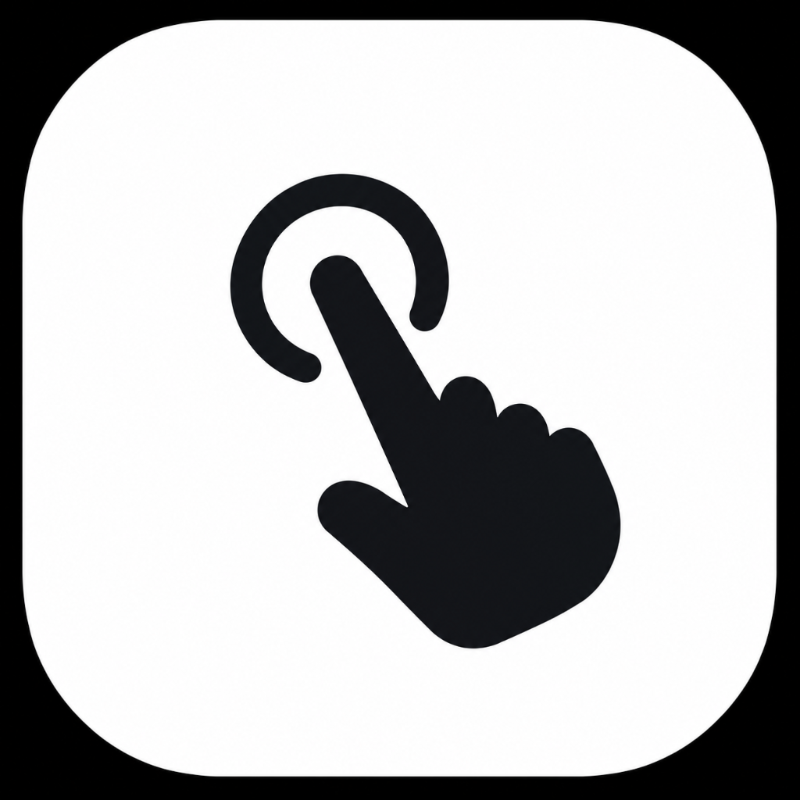

<p align="center">
  
</p>

<h1 align="center">Swipy</h1>

<p align="center">
  <strong>Touchless macOS Gesture Control Powered by On-Device Apple Vision</strong><br>
  <em>Your hands. Your Mac. No touch required.</em>
</p>

<p align="center">
  
  
  
  
  
</p>

---

## 1. Overview

**Swipy** is a production-grade, native macOS application that transforms the MacBook's built-in FaceTime HD camera into a precision touchless trackpad. Users control the real macOS system cursor, click, drag, scroll, switch apps, and navigate Spaces using natural hand gestures.

- **100% Local-First Machine Learning**: Powered exclusively by Apple's native `VNDetectHumanHandPoseRequest`. Video frames are analyzed in memory and immediately discarded. No cloud servers, no telemetry, no tracking.
- **Real OS Integration**: Injects true hardware input events via Core Graphics (`CGWarpMouseCursorPosition`, `CGEvent`).
- **Custom Pointer HUD**: Sleek on-screen floating reticle (Vision Pro Ring, Glow Halo, Laser Dot, Crosshair) with spring-animated pinch compression and click ripples.
- **Adaptive Acceleration**: Non-linear power curve damping micro-tremors for pixel accuracy while accelerating fast sweeps across multi-monitor setups.
- **Pure-White Apple Minimalism**: Built with SwiftUI and AppKit following Apple Human Interface Guidelines.

---

## 2. Gesture Cheatsheet

| Gesture | Hand Pose | macOS Action |
|:---|:---|:---|
| **Cursor Move** | Index finger pointing | Moves macOS cursor with One Euro adaptive jitter filter |
| **Left Click** | Thumb + index quick pinch (< 250ms) | Synthesizes standard left click |
| **Double Click** | Two quick pinches within 380ms | Synthesizes double click |
| **Right Click** | Thumb + middle finger pinch | Synthesizes contextual right click |
| **Drag & Drop** | Sustained thumb + index pinch (> 250ms) + move | Holds mouse button down, drags, releases on unpinch |
| **Two-Finger Scroll** | Index & middle fingers extended parallel | Pixel-accurate vertical and horizontal scrolling |
| **Mission Control** | Three fingers swipe up | Triggers Mission Control (`Ctrl + Up`) |
| **Show Desktop** | Three fingers swipe down | Reveals Desktop (`Ctrl + Down`) |
| **Previous Space** | Three fingers swipe left | Navigates to previous macOS Space (`Ctrl + Left`) |
| **Next Space** | Three fingers swipe right | Navigates to next macOS Space (`Ctrl + Right`) |
| **App Switcher** | Four fingers swipe horizontally | Activates application switching (Command+Tab or floating dock) |
| **Emergency Pause** | Global hotkey `Option + Escape` or Menu Bar | Instantly suspends camera capture and releases cursor |

---

## 3. Architecture

Swipy is architected across 6 decoupled modules adhering to a strict 500-line physical ceiling per file:

```text
Swipy/
├── Resources/
│   ├── AppIcon.icns                       # macOS Finder & Dock multi-resolution iconset
│   └── AppLogo.png                        # Official 1024x1024 squircle brandmark
├── scripts/
│   ├── bundle_app.sh                      # Builds release binary, packages Swipy.app & codesigns
│   └── verify_all_skills.sh               # Runs full automated test suite
├── Sources/
│   ├── SwipyCore/                         # Pure domain library (Zero UI dependencies)
│   │   ├── Camera/                        # AVFoundation capture pipeline & TCC permissions
│   │   ├── Vision/                        # Apple Vision VNDetectHumanHandPoseRequest service
│   │   ├── Gestures/                      # Temporal state machine, sliding window, hysteresis
│   │   ├── Input/                         # Core Graphics mouse, scroll, and shortcut synthesis
│   │   ├── Configuration/                 # Strongly typed Codable settings & pointer models
│   │   └── Utilities/                     # One Euro filter, CoordinateMapper, CursorAcceleration
│   └── Swipy/                             # Main application & SwiftUI presentation layer
│       ├── App/                           # SwipyApp, AppDelegate, AppLifecycleManager
│       ├── Features/                      # Dashboard, Gestures, Calibration, Pointer, Onboarding
│       └── MenuBar/                       # NSStatusItem controller & MenuBarPopover
└── Tests/SwipyTests/                      # Automated unit test suite (41 assertions)
```

For complete technical documentation, see [ARCHITECTURE.md](ARCHITECTURE.md).

---

## 4. Quick Start

### Running the Pre-Packaged App Bundle
```bash
open build/Swipy.app
```

### Building From Source
```bash
# Clone the repository
git clone https://github.com/darknecrocities/Swipy.git
cd Swipy

# Build debug binary
swift build

# Run automated unit tests
swift run SwipyTestRunner

# Package release .app bundle signed with camera entitlements
bash scripts/bundle_app.sh
```

---

## 5. macOS Permissions & Privacy

Swipy requires two standard macOS privacy permissions to function:

1. **Camera Access**:
   - Required by AVFoundation to analyze hand poses in real time.
   - When launching `build/Swipy.app`, macOS displays a system permission dialog. Click **Allow**.
   - Swipy appears under **System Settings > Privacy & Security > Camera**.
2. **Accessibility Trust**:
   - Required by Core Graphics to position the system cursor (`CGWarpMouseCursorPosition`) and dispatch synthetic click events across applications.
   - Prompted on first launch or accessible via the Swipy Dashboard.

---

## 6. Contributing & Guidelines

Contributions are welcome! Please consult [CONTRIBUTING.md](CONTRIBUTING.md) for code style standards, line limit guardrails, and PR verification procedures.

---

## 7. License

MIT License. See [LICENSE](LICENSE) for details.
